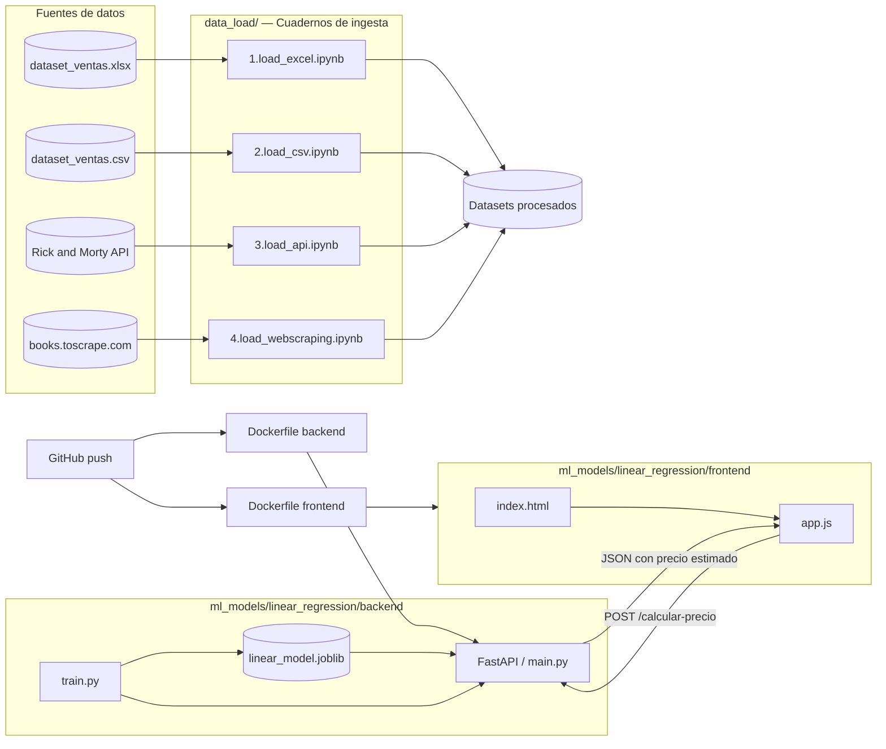
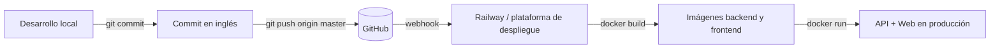

# Machine Learning — De la ingesta de datos a la tasación de viviendas

Repositorio de trabajo del trimestre: cubre el ciclo completo de un proyecto de machine learning, desde la **carga y exploración de datos** (`data_load/`) hasta un **modelo de regresión lineal** expuesto como API y consumido por una interfaz web, todo preparado para ejecutarse en contenedores Docker y desplegarse ante cada push a GitHub.

---

## Índice

1. [Visión general](#1-visión-general)
2. [Arquitectura](#2-arquitectura)
3. [Estructura del repositorio](#3-estructura-del-repositorio)
4. [Capa 1 — Ingesta y preparación de datos](#4-capa-1--ingesta-y-preparación-de-datos)
5. [Capa 2 — Modelo de regresión lineal](#5-capa-2--modelo-de-regresión-lineal)
6. [Capa 3 — API de inferencia](#6-capa-3--api-de-inferencia)
7. [Capa 4 — Interfaz web](#7-capa-4--interfaz-web)
8. [Capa 5 — Contenedores y despliegue](#8-capa-5--contenedores-y-despliegue)
9. [Puesta en marcha local](#9-puesta-en-marcha-local)
10. [Validación y pruebas](#10-validación-y-pruebas)
11. [Decisiones de diseño](#11-decisiones-de-diseño)
12. [Limitaciones y próximos pasos](#12-limitaciones-y-próximos-pasos)

---

## 1. Visión general

El proyecto está organizado en **cuatro capas desacopladas**:

| Capa | Responsabilidad | Tecnología |
|---|---|---|
| Ingesta | Obtener datos de Excel, CSV, APIs REST y web scraping | Pandas, Requests, BeautifulSoup |
| Modelo | Entrenar y serializar un estimador de precios | scikit-learn, joblib |
| Servicio | Exponer el modelo como HTTP JSON | FastAPI, Uvicorn, Pydantic |
| Presentación | Permitir al usuario estimar el precio de un inmueble | HTML, CSS, JavaScript vanilla |

Cada capa puede ejecutarse de forma independiente. La API y el frontend se empaquetan en imágenes Docker separadas, de modo que puedan desplegarse —y escalarse— por separado.

---

## 2. Arquitectura



### Flujo de una predicción

1. El usuario elige una superficie en metros cuadrados en el navegador.
2. `app.js` valida el valor contra la lista soportada y envía `POST /calcular-precio`.
3. FastAPI valida el cuerpo con un modelo Pydantic (`metros_cuadrados > 0`).
4. `obtener_modelo()` carga el artefacto `joblib` una sola vez y lo mantiene en caché.
5. El modelo devuelve el precio estimado en COP.
6. El frontend formatea el resultado, anima el valor y actualiza el gráfico comparativo.

---

## 3. Estructura del repositorio

```text
Machine-Learning/
├── data_load/
│   ├── 1.load_excel.ipynb          # Carga y limpieza desde Excel
│   ├── 2.load_csv.ipynb            # Carga y limpieza desde CSV
│   ├── 3.load_api.ipynb            # Consumo de API REST con paginación
│   ├── 4.load_webscraping.ipynb    # Scraping de libros
│   └── data/
│       ├── characters.csv          # 20 filas · 12 columnas
│       ├── dataset_ventas.csv      # 1000 filas · 7 columnas
│       ├── dataset_ventas.xlsx     # 1000 filas · 7 columnas
│       └── web_scraping_libros.csv # 880 filas · 4 columnas
└── ml_models/
    └── linear_regression/
        ├── backend/
        │   ├── Dockerfile          # Imagen de la API (puerto 8001)
        │   ├── main.py             # Aplicación FastAPI
        │   ├── train.py            # Entrenamiento y guardado del modelo
        │   ├── requirements.txt    # Dependencias de la API
        │   └── model/
        │       └── linear_model.joblib  # Artefacto versionado
        └── frontend/
            ├── Dockerfile          # Imagen del sitio estático (puerto 8001)
            ├── index.html          # Estructura y accesibilidad
            ├── styles.css          # Diseño visual y responsive
            ├── app.js              # Lógica, validación y consumo de la API
            └── requirements.txt    # Dependencias del frontend
```

---

## 4. Capa 1 — Ingesta y preparación de datos

Los cuadernos de `data_load/` son una **bitácora exploratoria** de las técnicas de carga y preparación. Cada uno parte de una fuente distinta y aplica transformaciones representativas.

| Cuaderno | Fuente | Salida | Técnicas principales |
|---|---|---|---|
| `1.load_excel.ipynb` | `dataset_ventas.xlsx` | `DataFrame` | `read_excel`, `info`, `describe`, detección de nulos, `dropna`, `fillna`, imputación por media, duplicados, `LabelEncoder`, `get_dummies`, `MinMaxScaler`, `StandardScaler`, SMOTE |
| `2.load_csv.ipynb` | `dataset_ventas.csv` | `DataFrame` | `read_csv`, exploración, limpieza de nulos y duplicados, codificación categórica, normalización, estandarización, SMOTE |
| `3.load_api.ipynb` | Rick and Morty REST API | `characters.csv` | `requests.get`, paginación con `info.next`, `raise_for_status`, normalización a `DataFrame`, proyección de columnas, exportación UTF-8-SIG |
| `4.load_webscraping.ipynb` | `books.toscrape.com` | `web_scraping_libros.csv` | `requests` + `BeautifulSoup`, selección de `article.product_pod`, extracción de título/precio/disponibilidad/valoración, mapeo `One…Five → 1…5`, exportación |

### Datasets incluidos

| Archivo | Filas | Columnas | Uso |
|---|---:|---:|---|
| `dataset_ventas.xlsx` / `.csv` | 1000 | `fecha, ciudad, categoria, producto, cantidad, precio_unitario, total_venta` | Ejercicios de limpieza, codificación y escalado |
| `characters.csv` | 20 | `id, name, status, species, type, gender, origin, location, image, episode, url, created` | Resultado de la ingesta desde API |
| `web_scraping_libros.csv` | 880 | `nombre, precio, disponibilidad, calificacion` | Resultado del scraping |

> **Nota de diseño:** los cuadernos son demostrativos y no alimentan directamente el modelo de tasación. El modelo usa un conjunto curado de pares superficie/precio, documentado en la siguiente sección. Esta separación mantiene la exploración de datos y el artefacto de producción desacoplados.

---

## 5. Capa 2 — Modelo de regresión lineal

### 5.1 Entrenamiento

`train.py` entrena un `LinearRegression` de scikit-learn con pares **superficie (m²) → precio (COP)**:

| Superficie (m²) | Precio (COP) |
|---:|---:|
| 70 | 420.000.000 |
| 80 | 800.000.000 |
| 90 | 1.700.000.000 |
| 110 | 1.900.000.000 |
| 120 | 2.500.000.000 |
| 130 | 3.000.000.000 |
| 140 | 3.500.000.000 |
| 150 | 4.000.000.000 |

El script crea la carpeta `model/` si no existe y guarda el estimador con `joblib.dump`.

```python
model = LinearRegression()
model.fit(x, y)
MODEL_PATH.parent.mkdir(parents=True, exist_ok=True)
joblib.dump(model, MODEL_PATH)
```

### 5.2 Artefacto y comportamiento

Propiedades del modelo serializado:

| Métrica | Valor |
|---|---:|
| Coeficiente (pendiente) | `42.959.660,30` COP / m² |
| Intercepto | `-2.551.762.208,07` COP |
| R² sobre los datos de entrenamiento | `0,9769` |
| Estimación para 100 m² | `1.744.203.821,66` COP |

El artefacto `backend/model/linear_model.joblib` está versionado, por lo que **el contenedor no necesita entrenar en el arranque**: puede servir inferencias de inmediato. Si se quiere regenerar:

```bash
cd ml_models/linear_regression/backend
python train.py
```

---

## 6. Capa 3 — API de inferencia

Implementada en `backend/main.py` con FastAPI.

### Endpoints

| Método | Ruta | Descripción | Respuesta |
|---|---|---|---|
| `GET` | `/` | Información del servicio y disponibilidad del modelo | `{ mensaje, endpoint, ejemplo_body, modelo_disponible }` |
| `POST` | `/calcular-precio` | Estima el precio para una superficie | `{ metros_cuadrados, precio_estimado, moneda }` |

### Contrato

```json
// Request
{ "metros_cuadrados": 100 }

// Response 200
{
  "metros_cuadrados": 100.0,
  "precio_estimado": 1744203821.66,
  "moneda": "COP"
}
```

### Comportamientos relevantes

- **Validación:** Pydantic rechaza valores `<= 0` y `> 100.000` con HTTP `422`.
- **CORS:** `allow_origins=["*"]`, pensado para que el frontend desplegado en otro dominio pueda consumir la API.
- **Carga diferida y cacheada:** `@lru_cache(maxsize=1)` evita leer el `.joblib` en cada petición.
- **Degradación controlada:** si el artefacto no existe, responde `503 Service Unavailable` con un mensaje accionable.
- **Documentación automática:** FastAPI expone `/docs` y `/openapi.json`.

---

## 7. Capa 4 — Interfaz web

Frontend estático sin frameworks: `index.html`, `styles.css` y `app.js`.

### Funcionalidades

- **Presets** de 70, 80, 90, 110, 120, 130, 140 y 150 m², alineados con los datos de entrenamiento.
- **Validación client-side** con mensajes accesibles (`aria-invalid`, `role="alert"`).
- **Configuración del endpoint** mediante `localStorage` (`tasador.apiBaseUrl`), con valor por defecto apuntando al backend desplegado en Railway y opción de usar `http://localhost:8000`.
- **Manejo de errores:** timeout de 10 s, `AbortController`, mensajes específicos para `503`, fallos de red y respuestas inválidas.
- **Presentación:** formato de moneda colombiana (`Intl.NumberFormat("es-CO")`), animación del precio y marcador en un gráfico SVG.
- **Accesibilidad y responsive:** etiquetas, estados de carga y diseño adaptable.

> El frontend no contiene lógica de negocio: únicamente consume `POST /calcular-precio` y presenta el resultado.

---

## 8. Capa 5 — Contenedores y despliegue

### Dockerfiles

| Servicio | Ruta | Base | Puerto por defecto | Comando |
|---|---|---|---:|---|
| API | `ml_models/linear_regression/backend/Dockerfile` | `python:3.12-slim` | `8001` | `uvicorn main:app --host 0.0.0.0 --port ${PORT:-8001}` |
| Web | `ml_models/linear_regression/frontend/Dockerfile` | `python:3.12-slim` | `8001` | `python -m http.server ${PORT:-8001} --bind 0.0.0.0` |

Ambos declaran `EXPOSE 8001` y respetan la variable de entorno `PORT`. Esto permite:

- Ejecutar localmente sin configurar nada (escuchan en `8001`).
- Desplegar en Railway/Render/Fly.io, donde la plataforma inyecta `PORT` y el contenedor se adapta automáticamente.

### Flujo de despliegue



> El Dockerfile **define** la imagen; el disparo automático del build lo hace la plataforma de despliegue al recibir el push. Por eso ambos servicios tienen su propio Dockerfile en la raíz de su carpeta.

---

## 9. Puesta en marcha local

### Opción A — Sin Docker

```bash
# Backend
cd ml_models/linear_regression/backend
python -m venv .venv && source .venv/bin/activate
pip install -r requirements.txt
python train.py                       # solo si falta el artefacto
uvicorn main:app --host 0.0.0.0 --port 8001
```

```bash
# Frontend (otra terminal)
cd ml_models/linear_regression/frontend
python -m http.server 8001 --bind 0.0.0.0
```

Abre `http://localhost:8001` y, en el panel de configuración del frontend, apunta la API a `http://localhost:8000` (o al puerto donde levantes el backend).

### Opción B — Con Docker

```bash
# Backend
docker build -t tasador-backend -f ml_models/linear_regression/backend/Dockerfile ml_models/linear_regression/backend
docker run --rm -p 8001:8001 tasador-backend

# Frontend
docker build -t tasador-frontend -f ml_models/linear_regression/frontend/Dockerfile ml_models/linear_regression/frontend
docker run --rm -p 8002:8001 tasador-frontend
```

Para simular un puerto inyectado por la plataforma:

```bash
docker run --rm -p 8003:8002 -e PORT=8002 tasador-backend
```

---

## 10. Validación y pruebas

Comprobaciones mínimas antes de publicar:

```bash
# Salud del servicio
curl http://localhost:8001/
# → "modelo_disponible": true

# Predicción válida
curl -X POST http://localhost:8001/calcular-precio \
  -H 'Content-Type: application/json' \
  -d '{"metros_cuadrados": 100}'
# → {"metros_cuadrados":100.0,"precio_estimado":1744203821.66,"moneda":"COP"}

# Validación de entrada (esperado 422)
curl -o /dev/null -w '%{http_code}' -X POST http://localhost:8001/calcular-precio \
  -H 'Content-Type: application/json' -d '{"metros_cuadrados": 0}'

# CORS
curl -i -X OPTIONS http://localhost:8001/calcular-precio \
  -H 'Origin: https://ejemplo.com' \
  -H 'Access-Control-Request-Method: POST' | grep -i access-control-allow-origin
```

Checklist acordado:

- [x] Sintaxis de `main.py` y `train.py`.
- [x] Carga del artefacto `linear_model.joblib`.
- [x] `GET /` y `POST /calcular-precio` responden correctamente.
- [x] Validación de entrada (`422`) y CORS (`*`).
- [x] Frontend sirve `index.html`, `app.js` y `styles.css`.
- [x] Ambos contenedores arrancan en `8001` por defecto y respetan `PORT`.
- [x] Dockerfiles alineados con la configuración de despliegue.

---

## 11. Decisiones de diseño

1. **Artefacto versionado.** Guardar `linear_model.joblib` en el repositorio evita entrenar durante el arranque y hace el despliegue determinista.
2. **API stateless.** Toda la inferencia depende solo del artifact y del cuerpo de la petición; no hay base de datos.
3. **Caché de modelo.** `lru_cache` reduce la latencia y la presión de E/S en cada petición.
4. **CORS abierto.** Necesario porque la UI y la API se despliegan en dominios distintos.
5. **Puerto configurable.** `${PORT:-8001}` unifica desarrollo local y entornos administrados sin duplicar imágenes.
6. **Frontend sin build step.** Servir HTML/CSS/JS con `http.server` mantiene la imagen minimalista y el arranque instantáneo.
7. **Separación de capas.** Los cuadernos de ingesta, el entrenamiento, la API y la UI evolucionan de forma independiente.
8. **Commits descriptivos en inglés.** Convención consistente con el historial del repositorio, p. ej. `Add backend and frontend Dockerfiles for containerized deployment`.

---

## 12. Limitaciones y próximos pasos

- El conjunto de entrenamiento está **embebido en `train.py`**; no se deriva todavía de los datasets de `data_load/`.
- No hay suites de pruebas automatizadas (`pytest`); la validación actual es manual y con `curl`.
- El frontend restringe la entrada a ocho valores predefinidos para reflejar el rango observado durante el entrenamiento.
- Los cuadernos usan SMOTE sobre una variable categórica (`ciudad`) con fines didácticos; conviene revisar esa decisión antes de usarlos en producción.
- Posibles mejoras: pipeline de entrenamiento reproducible, métricas en CI, split train/test, versionado de modelos con MLflow y `docker compose` para orquestar ambos servicios en local.

---

## Resumen

Este repositorio muestra un recorrido completo: **ingesta multidimensional → preparación de datos → modelo de regresión lineal → API REST → interfaz web → contenedores listos para despliegue**. Cada capa está documentada, es ejecutable por separado y conserva una configuración de puerto compatible con desarrollo local y despliegue administrado.
